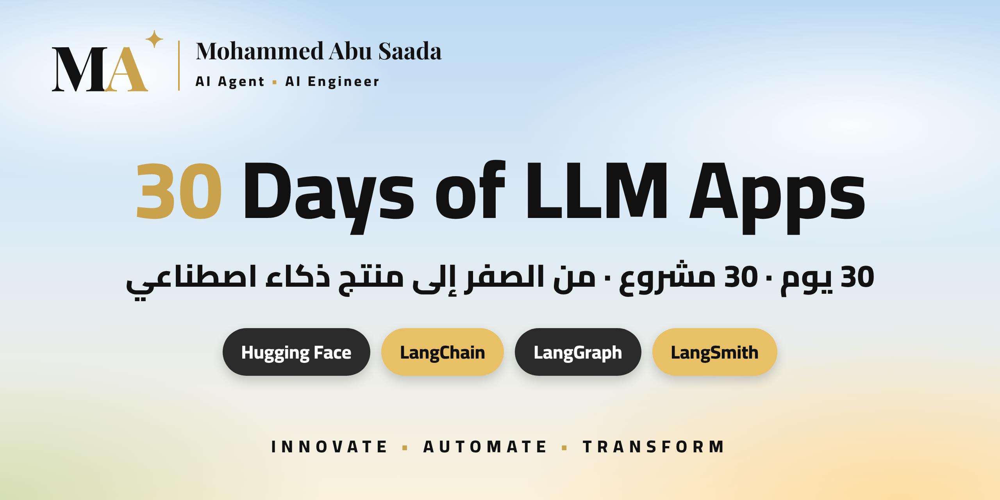
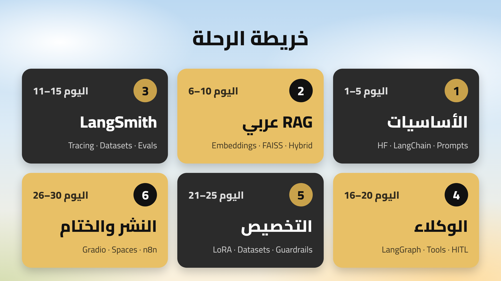

<p align="center">
  
</p>

<p align="center">
       
</p>

<div dir="rtl">

<h3 align="center">30 يوم · 30 مشروع · من الصفر إلى منتج ذكاء اصطناعي منشور ومُقيَّم</h3>

<p align="center">
بعد سلسلة <b>30 يوم n8n</b>، هذا التحدي يفتح الصندوق الأسود:<br>
نبني بأيدينا بـ <b>🤗 Hugging Face</b> · <b>🦜 LangChain / LangGraph</b> · <b>🛠️ LangSmith</b>
</p>

<table align="center">
<tr>
<td align="center">🎯<br><b>مشكلة حقيقية</b></td>
<td align="center">💻<br><b>كود يشتغل</b></td>
<td align="center">📖<br><b>شرح بالعربي</b></td>
<td align="center">📊<br><b>تقييم بالأرقام</b></td>
</tr>
</table>

---

## 🗺️ خريطة الرحلة

<p align="center"></p>

---

## ⚡ البدء السريع

```bash
git clone https://github.com/mohammed4122002/30-days-of-llm-apps.git
cd 30-days-of-llm-apps
python -m venv .venv && source .venv/bin/activate
pip install -r requirements.txt
cp .env.example .env   # أضف HF_TOKEN و LANGSMITH_API_KEY
python day-01/app.py
```

| المتغير | من أين تحصل عليه |
|---|---|
| `HF_TOKEN` | [huggingface.co/settings/tokens](https://huggingface.co/settings/tokens) |
| `LANGSMITH_API_KEY` | [smith.langchain.com](https://smith.langchain.com) ← Settings ← API Keys |

---

## 📅 الأيام الثلاثون

### 🟡 المرحلة 1 · الأساسيات
> Hugging Face و LangChain من الصفر

| # | المشروع | الأدوات | الحالة |
|:---:|---|---|:---:|
| **01** | [أول نموذج مفتوح المصدر يرد عليك](./day-01/README.md) | `Hugging Face Inference API` | ⬜ |
| **02** | [أول سلسلة LangChain: Prompt \| LLM \| Parser](./day-02/README.md) | `LangChain (LCEL)` | ⬜ |
| **03** | [قوالب Prompts ذكية: مترجم يغيّر اللهجة](./day-03/README.md) | `LangChain Prompt Templates` | ⬜ |
| **04** | [مخرجات منظمة: حوّل نص فوضوي إلى JSON نظيف](./day-04/README.md) | `Pydantic + PydanticOutputParser` | ⬜ |
| **05** | [ذاكرة المحادثة: بوت يتذكرك](./day-05/README.md) | `RunnableWithMessageHistory` | ⬜ |

### ⚫ المرحلة 2 · RAG عربي
> اسأل ملفاتك بدقة ومع مصادر

| # | المشروع | الأدوات | الحالة |
|:---:|---|---|:---:|
| **06** | [RAG الجزء 1: حمّل PDF عربي وقطّعه صح](./day-06/README.md) | `PyPDFLoader + RecursiveCharacterTextSplitter` | ⬜ |
| **07** | [RAG الجزء 2: Embeddings عربية + قاعدة متجهات](./day-07/README.md) | `HuggingFace Embeddings + FAISS` | ⬜ |
| **08** | [RAG الجزء 3: اسأل ملفاتك](./day-08/README.md) | `LangChain Retriever + LCEL` | ⬜ |
| **09** | [تحسين الاسترجاع: MMR + بحث هجين](./day-09/README.md) | `MMR + BM25 + EnsembleRetriever` | ⬜ |
| **10** | [RAG مع مصادر: كل إجابة معها دليلها](./day-10/README.md) | `LangChain Citations` | ⬜ |

### 🟡 المرحلة 3 · LangSmith
> تتبع، تقييم، ومقارنة بالأرقام

| # | المشروع | الأدوات | الحالة |
|:---:|---|---|:---:|
| **11** | [LangSmith: أول مرة أشوف داخل «العقل»](./day-11/README.md) | `LangSmith Tracing` | ⬜ |
| **12** | [ابنِ Dataset للتقييم: الأسئلة الذهبية](./day-12/README.md) | `LangSmith Datasets` | ⬜ |
| **13** | [تقييم تلقائي: نموذج يصحّح نموذج](./day-13/README.md) | `LangSmith evaluate + LLM-as-judge` | ⬜ |
| **14** | [معركة النماذج: A ضد B على نفس الأسئلة](./day-14/README.md) | `LangSmith Experiments` | ⬜ |
| **15** | [التكلفة والزمن والأخطاء: لوحة مراقبة](./day-15/README.md) | `LangSmith Tags, Metadata, Feedback` | ⬜ |

### ⚫ المرحلة 4 · الوكلاء
> LangGraph، أدوات، وموافقة بشرية

| # | المشروع | الأدوات | الحالة |
|:---:|---|---|:---:|
| **16** | [أول Agent: نموذج يستخدم أدوات](./day-16/README.md) | `LangGraph prebuilt agent + Tools` | ⬜ |
| **17** | [LangGraph: ارسم المنطق كخريطة](./day-17/README.md) | `LangGraph StateGraph` | ⬜ |
| **18** | [Agent ذكي بيقرر: يجاوب بمعرفته أم يبحث بملفاتك؟](./day-18/README.md) | `LangGraph Conditional Edges (Router)` | ⬜ |
| **19** | [الإنسان بالحلقة: الوكيل يستأذن قبل ما ينفّذ](./day-19/README.md) | `LangGraph Checkpointer + interrupt` | ⬜ |
| **20** | [فريق وكلاء: باحث + كاتب + محرّر](./day-20/README.md) | `LangGraph Multi-Agent` | ⬜ |

### 🟡 المرحلة 5 · التخصيص
> تصنيف عربي، LoRA، وأمان

| # | المشروع | الأدوات | الحالة |
|:---:|---|---|:---:|
| **21** | [تصنيف النصوص العربية بنموذج جاهز](./day-21/README.md) | `Transformers pipeline` | ⬜ |
| **22** | [ابنِ Dataset ونشره على Hugging Face Hub](./day-22/README.md) | `datasets + push_to_hub` | ⬜ |
| **23** | [Fine-tuning بـ LoRA: درّب نموذجك بدون GPU ضخم](./day-23/README.md) | `PEFT / LoRA + Trainer` | ⬜ |
| **24** | [هل تحسّن فعلًا؟ قارن الأساسي بالمضبوط](./day-24/README.md) | `evaluate + مقارنة المقاييس` | ⬜ |
| **25** | [حواجز الأمان: لا تثق بالمدخلات](./day-25/README.md) | `Guardrails (قواعد + LLM)` | ⬜ |

### ⚫ المرحلة 6 · النشر والختام
> Gradio، Spaces، n8n، ومشروع ختامي

| # | المشروع | الأدوات | الحالة |
|:---:|---|---|:---:|
| **26** | [واجهة Gradio: حوّل السكربت لتطبيق](./day-26/README.md) | `Gradio ChatInterface` | ⬜ |
| **27** | [انشر على Hugging Face Spaces: رابط يشاركه العالم](./day-27/README.md) | `HF Spaces + huggingface_hub` | ⬜ |
| **28** | [اربط عالمين: n8n + وكيل LangChain](./day-28/README.md) | `FastAPI + Webhook + n8n` | ⬜ |
| **29** | [الإنتاج: تتبع وتقييم مستمر](./day-29/README.md) | `LangSmith Production Monitoring` | ⬜ |
| **30** | [المشروع الختامي: منتج متكامل](./day-30/README.md) | `كل ما تعلمناه` | ⬜ |

---

## 🤝 شارك بالتحدي

- ⭐ **ضع نجمة** للمستودع لتتابع كل يوم جديد.
- 🍴 **اعمل Fork** وابنِ نسختك، وشاركها بوسم `#30DaysOfLLMApps`.
- 🐛 وجدت خطأ؟ افتح **Issue** أو **Pull Request**.

> ⚠️ الأكواد مكتوبة بحسب واجهات المكتبات الحالية، وقد تتغيّر الأسماء بين الإصدارات. إن واجهت خطأ، افتح Issue.

</div>

<p align="center"></p>
