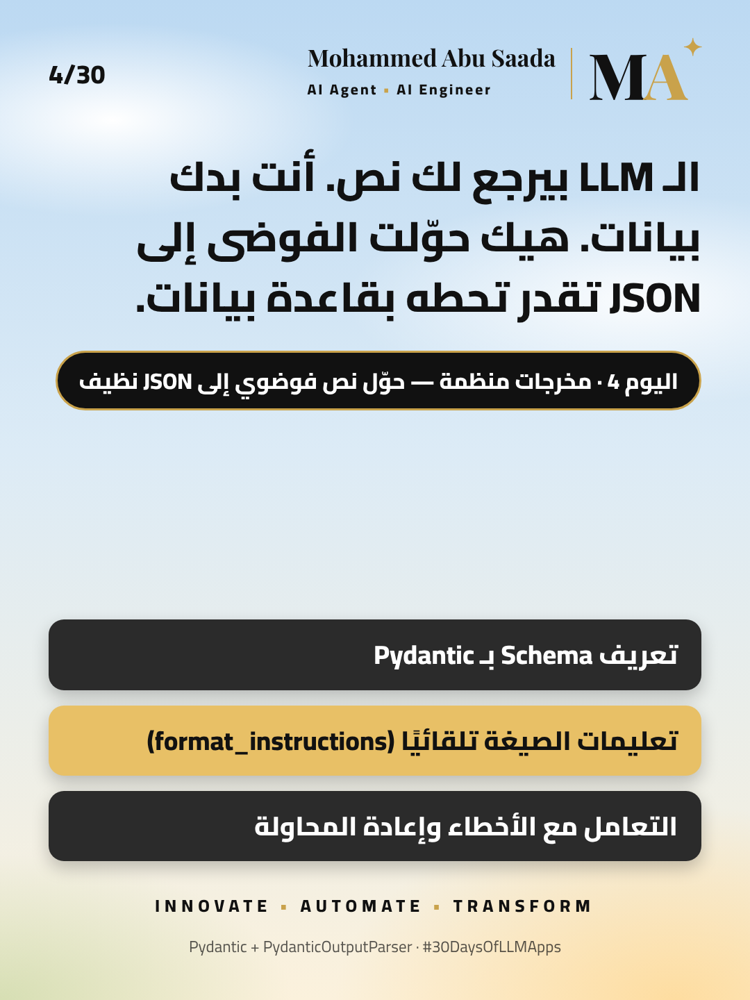

الـ LLM بيرجع لك نص. أنت بدك بيانات. هيك حوّلت الفوضى إلى JSON تقدر تحطه بقاعدة بيانات.

📅 اليوم 4 من 30 — مخرجات منظمة: حوّل نص فوضوي إلى JSON نظيف

🎯 المشكلة:
كيف أستخرج بيانات موثوقة من نص حر (فواتير، إيميلات)؟

🛠️ اللي بنيته اليوم (Pydantic + PydanticOutputParser):
✅ تعريف Schema بـ Pydantic
✅ تعليمات الصيغة تلقائيًا (format_instructions)
✅ التعامل مع الأخطاء وإعادة المحاولة

💡 الخلاصة: كل يوم خطوة صغيرة، وبعد 30 يوم الفرق بيكون ضخم.

كود اليوم كامل + شرح بالعربي على GitHub (الرابط بأول تعليق 👇)

شو أصعب نص حاولت تستخرج منه بيانات؟

🔁 شارك المنشور إذا بتعرف حدا بدو يبدأ رحلته بالذكاء الاصطناعي.

#الذكاء_الاصطناعي #LangChain #HuggingFace #LangSmith #LLM #AI #30DaysOfLLMApps

---
🖼️ **صورة المنشور:** 
