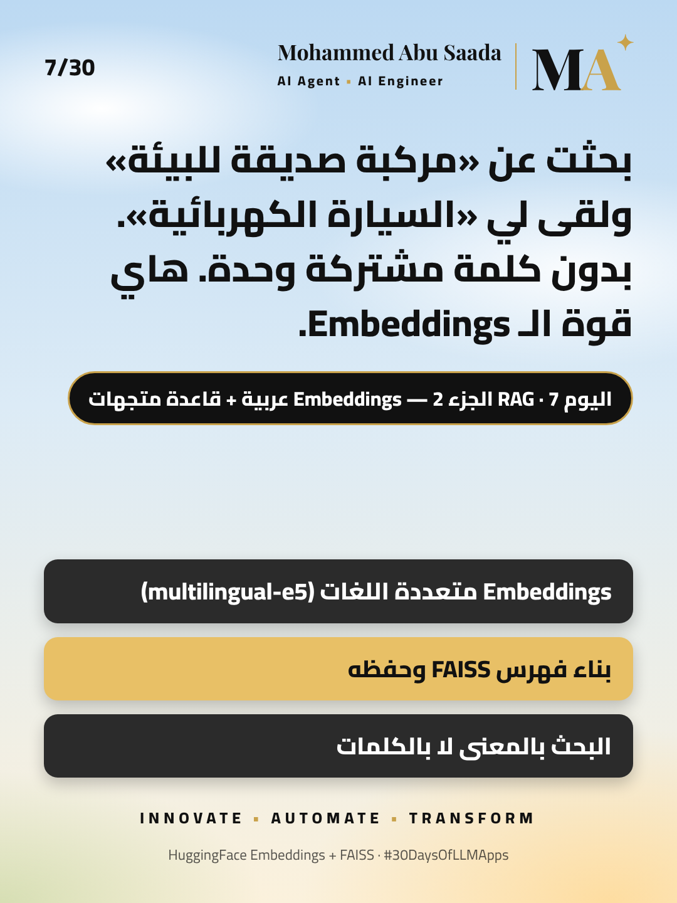

بحثت عن «مركبة صديقة للبيئة» ولقى لي «السيارة الكهربائية». بدون كلمة مشتركة وحدة. هاي قوة الـ Embeddings.

📅 اليوم 7 من 30 — RAG الجزء 2: Embeddings عربية + قاعدة متجهات

🎯 المشكلة:
كيف يفهم الكمبيوتر إن «سيارة» و«مركبة» نفس المعنى؟

🛠️ اللي بنيته اليوم (HuggingFace Embeddings + FAISS):
✅ Embeddings متعددة اللغات (multilingual-e5)
✅ بناء فهرس FAISS وحفظه
✅ البحث بالمعنى لا بالكلمات

💡 الخلاصة: كل يوم خطوة صغيرة، وبعد 30 يوم الفرق بيكون ضخم.

كود اليوم كامل + شرح بالعربي على GitHub (الرابط بأول تعليق 👇)

جربت نماذج embeddings عربية؟ أيها الأفضل؟

🔁 شارك المنشور إذا بتعرف حدا بدو يبدأ رحلته بالذكاء الاصطناعي.

#الذكاء_الاصطناعي #LangChain #HuggingFace #LangSmith #LLM #AI #30DaysOfLLMApps

---
🖼️ **صورة المنشور:** 
