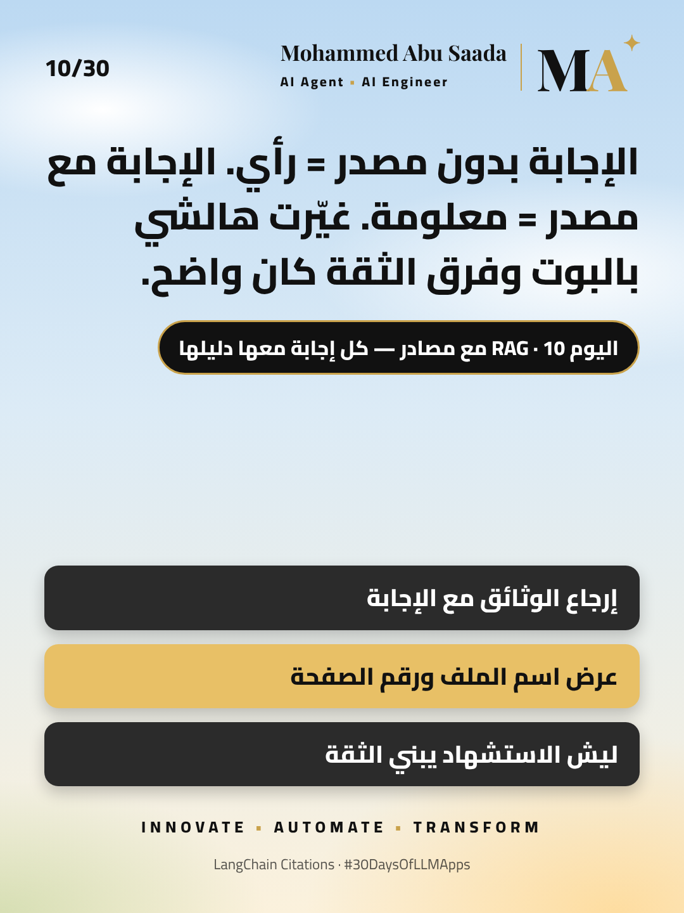

الإجابة بدون مصدر = رأي. الإجابة مع مصدر = معلومة. غيّرت هالشي بالبوت وفرق الثقة كان واضح.

📅 اليوم 10 من 30 — RAG مع مصادر: كل إجابة معها دليلها

🎯 المشكلة:
كيف أخلي المستخدم يثق بالإجابة؟

🛠️ اللي بنيته اليوم (LangChain Citations):
✅ إرجاع الوثائق مع الإجابة
✅ عرض اسم الملف ورقم الصفحة
✅ ليش الاستشهاد يبني الثقة

💡 الخلاصة: كل يوم خطوة صغيرة، وبعد 30 يوم الفرق بيكون ضخم.

كود اليوم كامل + شرح بالعربي على GitHub (الرابط بأول تعليق 👇)

بتثق بالذكاء الاصطناعي لما يعطيك مصدر؟

🔁 شارك المنشور إذا بتعرف حدا بدو يبدأ رحلته بالذكاء الاصطناعي.

#الذكاء_الاصطناعي #LangChain #HuggingFace #LangSmith #LLM #AI #30DaysOfLLMApps

---
🖼️ **صورة المنشور:** 
