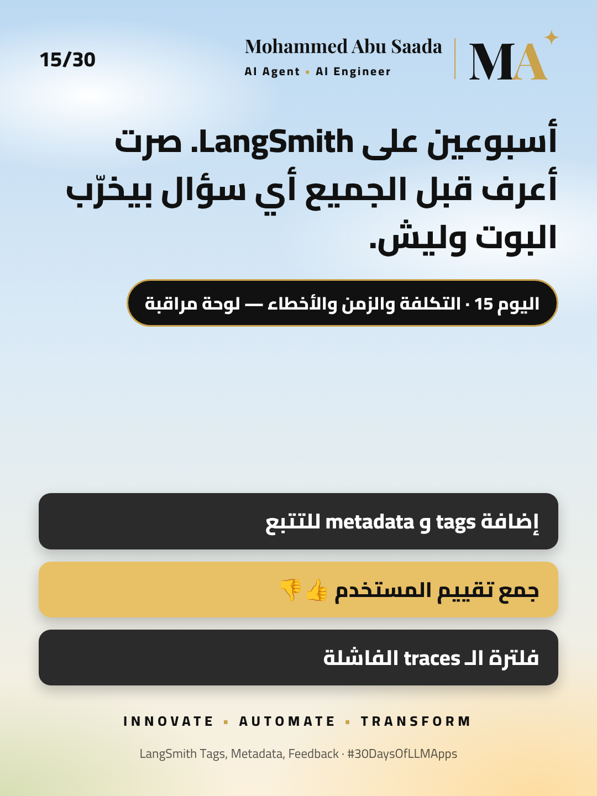

أسبوعين على LangSmith. صرت أعرف قبل الجميع أي سؤال بيخرّب البوت وليش.

📅 اليوم 15 من 30 — التكلفة والزمن والأخطاء: لوحة مراقبة

🎯 المشكلة:
كيف أكتشف الأعطال قبل ما يشتكي المستخدم؟

🛠️ اللي بنيته اليوم (LangSmith Tags, Metadata, Feedback):
✅ إضافة tags و metadata للتتبع
✅ جمع تقييم المستخدم 👍👎
✅ فلترة الـ traces الفاشلة

💡 الخلاصة: كل يوم خطوة صغيرة، وبعد 30 يوم الفرق بيكون ضخم.

كود اليوم كامل + شرح بالعربي على GitHub (الرابط بأول تعليق 👇)

شو أهم مؤشر بتراقبه بمشاريعك؟

🔁 شارك المنشور إذا بتعرف حدا بدو يبدأ رحلته بالذكاء الاصطناعي.

#الذكاء_الاصطناعي #LangChain #HuggingFace #LangSmith #LLM #AI #30DaysOfLLMApps

---
🖼️ **صورة المنشور:** 
