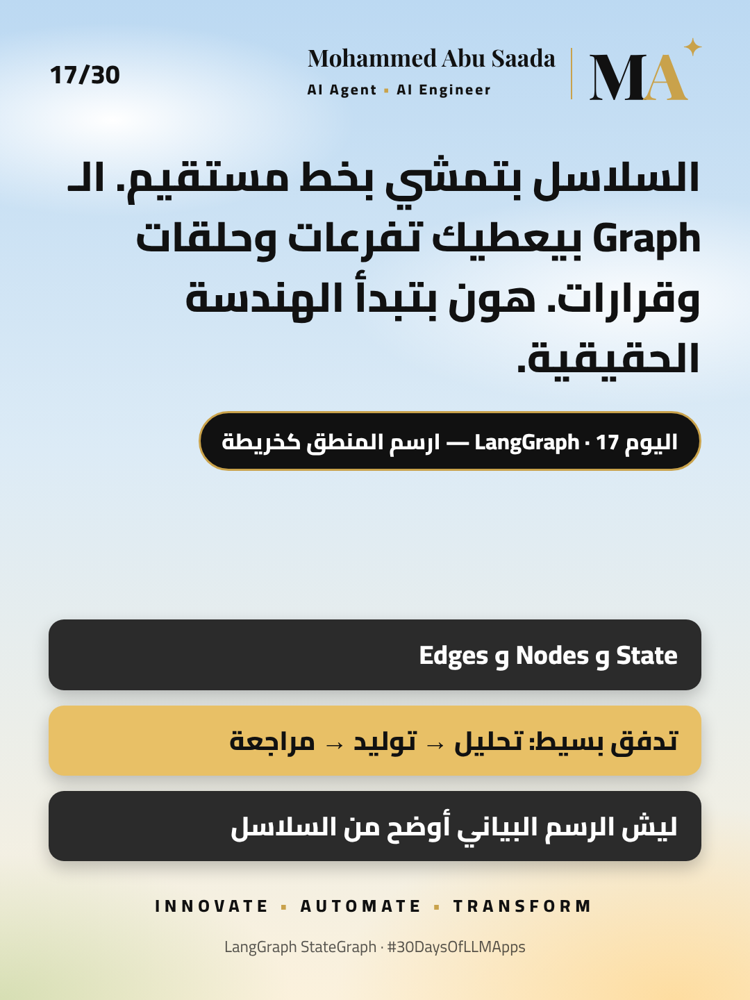

السلاسل بتمشي بخط مستقيم. الـ Graph بيعطيك تفرعات وحلقات وقرارات. هون بتبدأ الهندسة الحقيقية.

📅 اليوم 17 من 30 — LangGraph: ارسم المنطق كخريطة

🎯 المشكلة:
كيف أتحكم بتدفق الوكيل بدل ما أترك له كل شيء؟

🛠️ اللي بنيته اليوم (LangGraph StateGraph):
✅ State و Nodes و Edges
✅ تدفق بسيط: تحليل → توليد → مراجعة
✅ ليش الرسم البياني أوضح من السلاسل

💡 الخلاصة: كل يوم خطوة صغيرة، وبعد 30 يوم الفرق بيكون ضخم.

كود اليوم كامل + شرح بالعربي على GitHub (الرابط بأول تعليق 👇)

بتفضّل Chains ولا Graphs؟

🔁 شارك المنشور إذا بتعرف حدا بدو يبدأ رحلته بالذكاء الاصطناعي.

#الذكاء_الاصطناعي #LangChain #HuggingFace #LangSmith #LLM #AI #30DaysOfLLMApps

---
🖼️ **صورة المنشور:** 
