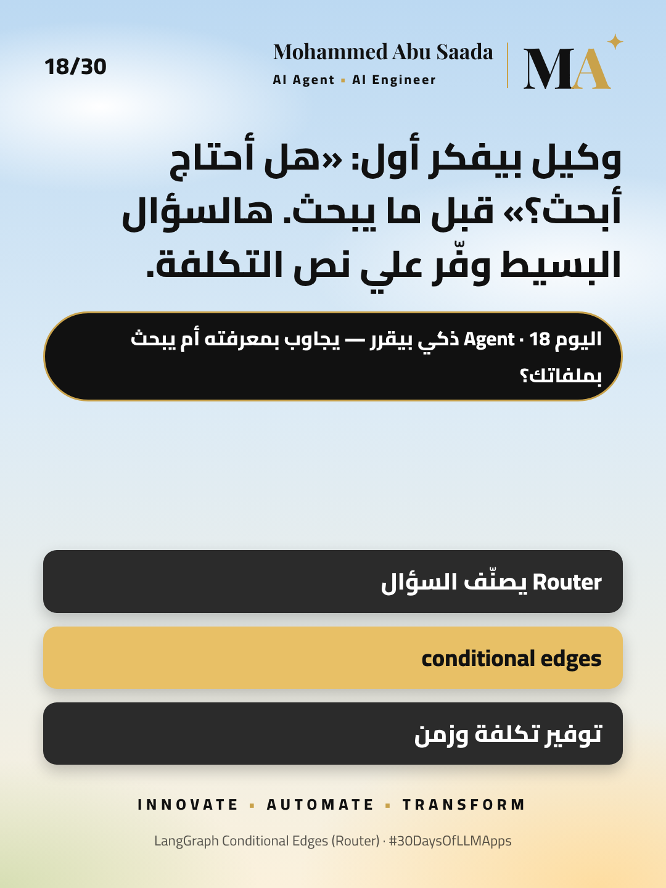

وكيل بيفكر أول: «هل أحتاج أبحث؟» قبل ما يبحث. هالسؤال البسيط وفّر علي نص التكلفة.

📅 اليوم 18 من 30 — Agent ذكي بيقرر: يجاوب بمعرفته أم يبحث بملفاتك؟

🎯 المشكلة:
ليش أبحث بالملفات لسؤال بسيط؟ وليش أخمّن لسؤال محتاج مصدر؟

🛠️ اللي بنيته اليوم (LangGraph Conditional Edges (Router)):
✅ Router يصنّف السؤال
✅ conditional edges
✅ توفير تكلفة وزمن

💡 الخلاصة: كل يوم خطوة صغيرة، وبعد 30 يوم الفرق بيكون ضخم.

كود اليوم كامل + شرح بالعربي على GitHub (الرابط بأول تعليق 👇)

كيف بتقرر متى تستخدم RAG؟

🔁 شارك المنشور إذا بتعرف حدا بدو يبدأ رحلته بالذكاء الاصطناعي.

#الذكاء_الاصطناعي #LangChain #HuggingFace #LangSmith #LLM #AI #30DaysOfLLMApps

---
🖼️ **صورة المنشور:** 
