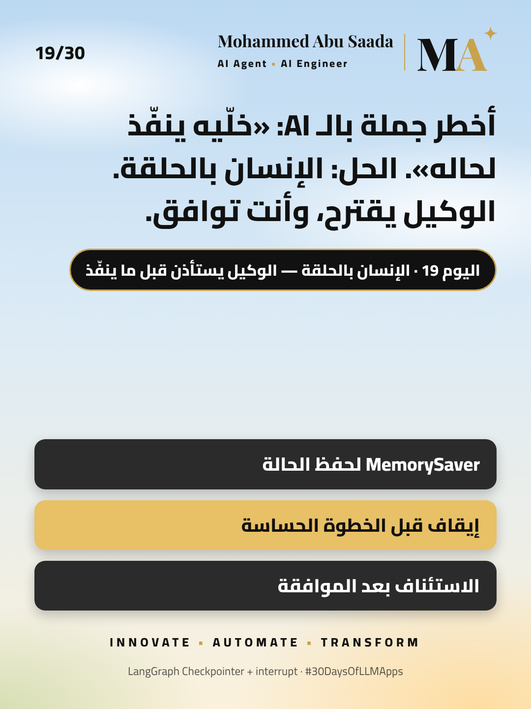

أخطر جملة بالـ AI: «خلّيه ينفّذ لحاله». الحل: الإنسان بالحلقة. الوكيل يقترح، وأنت توافق.

📅 اليوم 19 من 30 — الإنسان بالحلقة: الوكيل يستأذن قبل ما ينفّذ

🎯 المشكلة:
كيف أضمن إن الوكيل ما يرسل إيميل أو يمسح شيء لحاله؟

🛠️ اللي بنيته اليوم (LangGraph Checkpointer + interrupt):
✅ MemorySaver لحفظ الحالة
✅ إيقاف قبل الخطوة الحساسة
✅ الاستئناف بعد الموافقة

💡 الخلاصة: كل يوم خطوة صغيرة، وبعد 30 يوم الفرق بيكون ضخم.

كود اليوم كامل + شرح بالعربي على GitHub (الرابط بأول تعليق 👇)

أي مهام ما بتسلّمها لوكيل أبدًا؟

🔁 شارك المنشور إذا بتعرف حدا بدو يبدأ رحلته بالذكاء الاصطناعي.

#الذكاء_الاصطناعي #LangChain #HuggingFace #LangSmith #LLM #AI #30DaysOfLLMApps

---
🖼️ **صورة المنشور:** 
