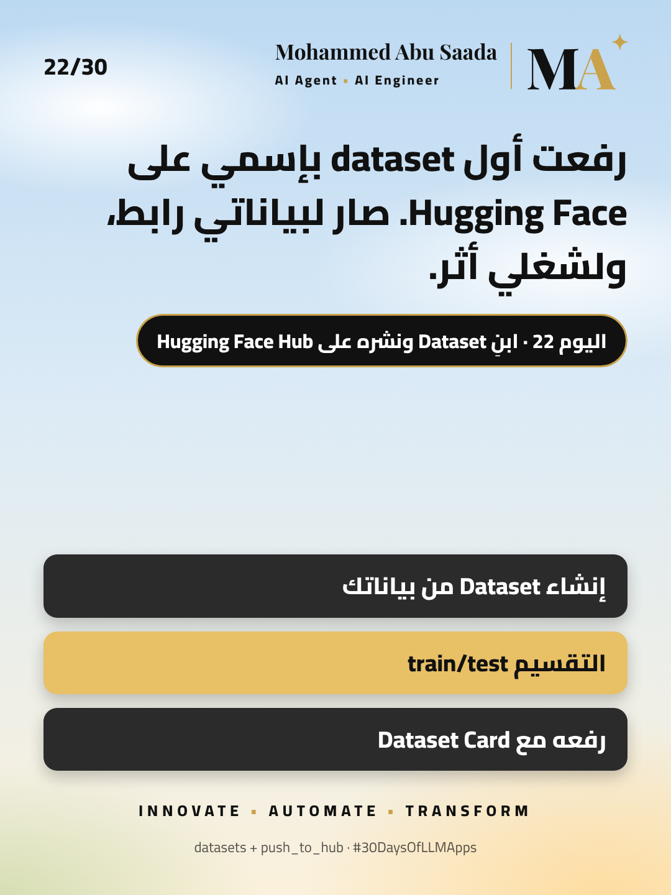

رفعت أول dataset بإسمي على Hugging Face. صار لبياناتي رابط، ولشغلي أثر.

📅 اليوم 22 من 30 — ابنِ Dataset ونشره على Hugging Face Hub

🎯 المشكلة:
البيانات هي الميزة التنافسية الحقيقية. كيف أنظّمها وأشاركها؟

🛠️ اللي بنيته اليوم (datasets + push_to_hub):
✅ إنشاء Dataset من بياناتك
✅ التقسيم train/test
✅ رفعه مع Dataset Card

💡 الخلاصة: كل يوم خطوة صغيرة، وبعد 30 يوم الفرق بيكون ضخم.

كود اليوم كامل + شرح بالعربي على GitHub (الرابط بأول تعليق 👇)

شو dataset عربي ناقص بالمجتمع برأيك؟

🔁 شارك المنشور إذا بتعرف حدا بدو يبدأ رحلته بالذكاء الاصطناعي.

#الذكاء_الاصطناعي #LangChain #HuggingFace #LangSmith #LLM #AI #30DaysOfLLMApps

---
🖼️ **صورة المنشور:** 
