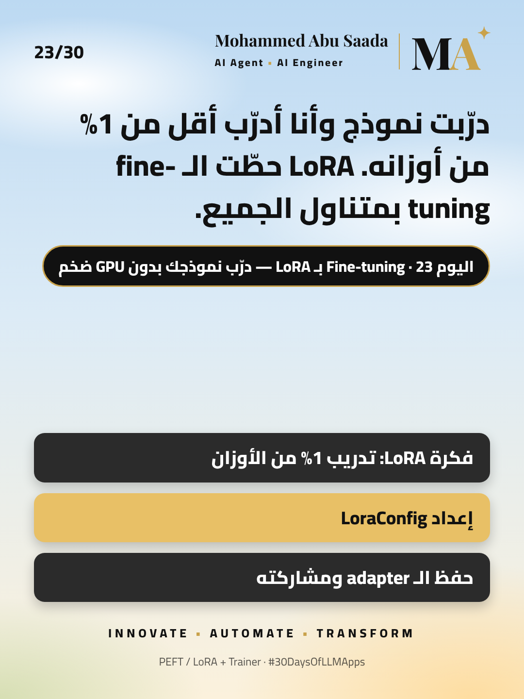

درّبت نموذج وأنا أدرّب أقل من 1% من أوزانه. LoRA حطّت الـ fine-tuning بمتناول الجميع.

📅 اليوم 23 من 30 — Fine-tuning بـ LoRA: درّب نموذجك بدون GPU ضخم

🎯 المشكلة:
كيف أعلّم النموذج أسلوبي أو مجالي بتكلفة بسيطة؟

🛠️ اللي بنيته اليوم (PEFT / LoRA + Trainer):
✅ فكرة LoRA: تدريب 1% من الأوزان
✅ إعداد LoraConfig
✅ حفظ الـ adapter ومشاركته

💡 الخلاصة: كل يوم خطوة صغيرة، وبعد 30 يوم الفرق بيكون ضخم.

كود اليوم كامل + شرح بالعربي على GitHub (الرابط بأول تعليق 👇)

شو مجال بتتمنى تدرّب عليه نموذج؟

🔁 شارك المنشور إذا بتعرف حدا بدو يبدأ رحلته بالذكاء الاصطناعي.

#الذكاء_الاصطناعي #LangChain #HuggingFace #LangSmith #LLM #AI #30DaysOfLLMApps

---
🖼️ **صورة المنشور:** 
