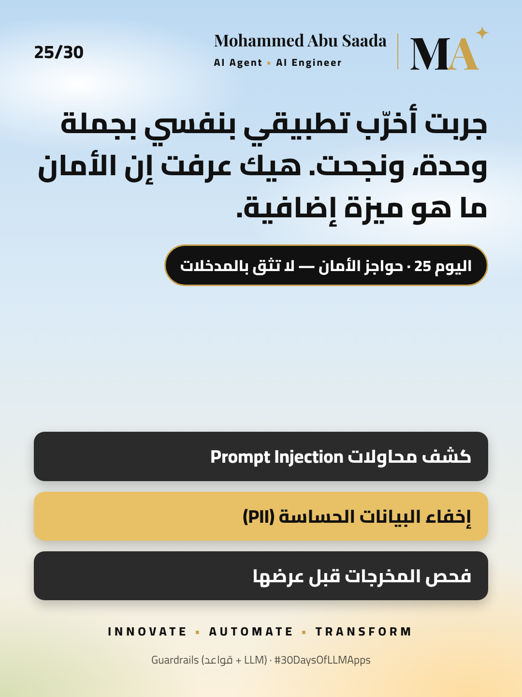

جربت أخرّب تطبيقي بنفسي بجملة وحدة، ونجحت. هيك عرفت إن الأمان ما هو ميزة إضافية.

📅 اليوم 25 من 30 — حواجز الأمان: لا تثق بالمدخلات

🎯 المشكلة:
كيف أحمي تطبيقي من Prompt Injection وتسريب البيانات؟

🛠️ اللي بنيته اليوم (Guardrails (قواعد + LLM)):
✅ كشف محاولات Prompt Injection
✅ إخفاء البيانات الحساسة (PII)
✅ فحص المخرجات قبل عرضها

💡 الخلاصة: كل يوم خطوة صغيرة، وبعد 30 يوم الفرق بيكون ضخم.

كود اليوم كامل + شرح بالعربي على GitHub (الرابط بأول تعليق 👇)

هل اختبرت تطبيقك ضد Prompt Injection؟

🔁 شارك المنشور إذا بتعرف حدا بدو يبدأ رحلته بالذكاء الاصطناعي.

#الذكاء_الاصطناعي #LangChain #HuggingFace #LangSmith #LLM #AI #30DaysOfLLMApps

---
🖼️ **صورة المنشور:** 
