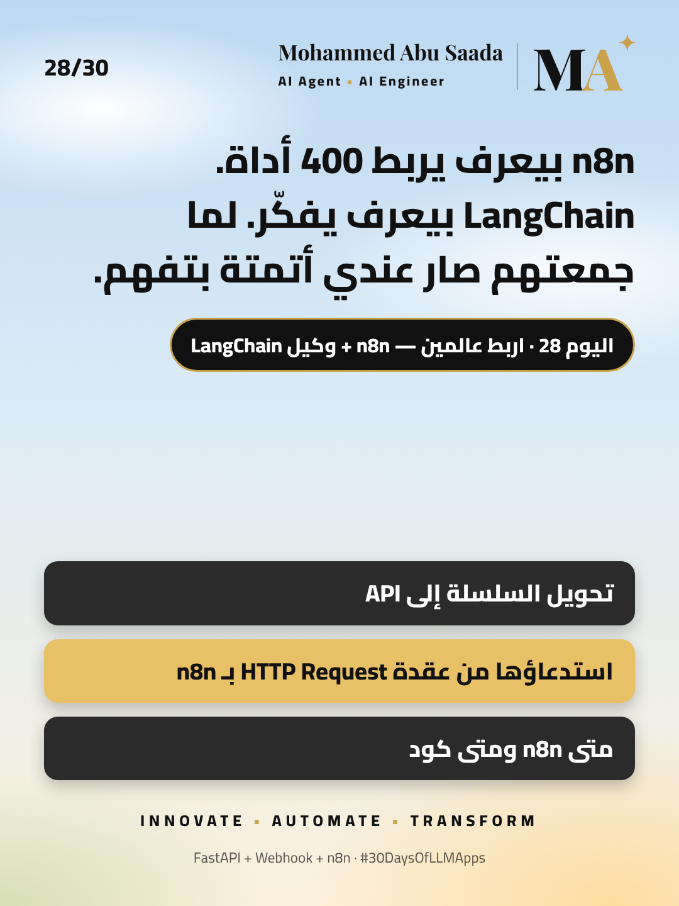

n8n بيعرف يربط 400 أداة. LangChain بيعرف يفكّر. لما جمعتهم صار عندي أتمتة بتفهم.

📅 اليوم 28 من 30 — اربط عالمين: n8n + وكيل LangChain

🎯 المشكلة:
كيف أستفيد من خبرتي بـ n8n مع قوة الذكاء الاصطناعي المبرمج؟

🛠️ اللي بنيته اليوم (FastAPI + Webhook + n8n):
✅ تحويل السلسلة إلى API
✅ استدعاؤها من عقدة HTTP Request بـ n8n
✅ متى n8n ومتى كود

💡 الخلاصة: كل يوم خطوة صغيرة، وبعد 30 يوم الفرق بيكون ضخم.

كود اليوم كامل + شرح بالعربي على GitHub (الرابط بأول تعليق 👇)

شو أول أتمتة بتبنيها لو جمعت n8n مع وكيل؟

🔁 شارك المنشور إذا بتعرف حدا بدو يبدأ رحلته بالذكاء الاصطناعي.

#الذكاء_الاصطناعي #LangChain #HuggingFace #LangSmith #LLM #AI #30DaysOfLLMApps

---
🖼️ **صورة المنشور:** 
